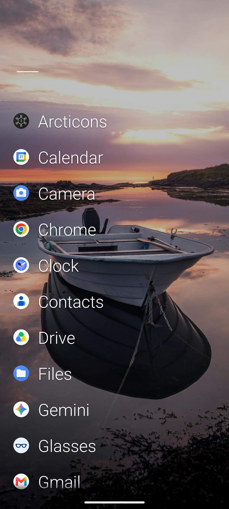
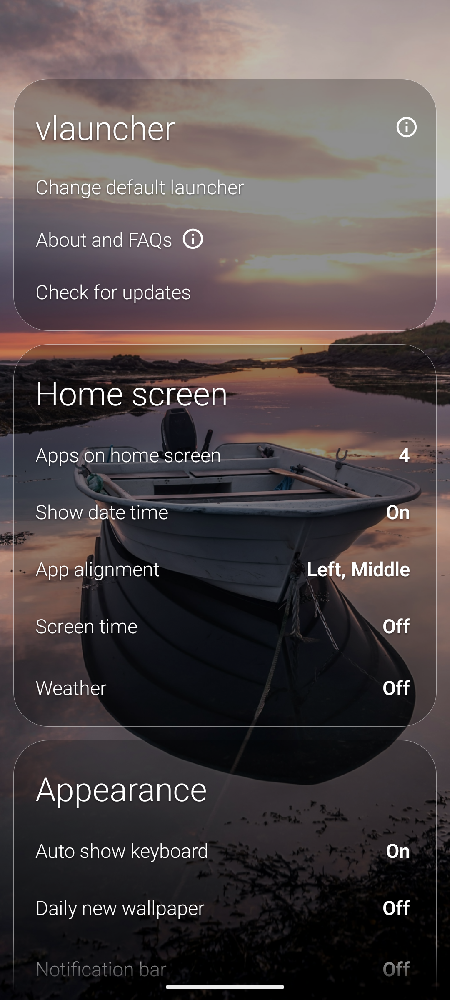

# vlauncher

A minimal, distraction-free Android launcher. A personal fork of
[Olauncher](https://github.com/tanujnotes/Olauncher) that keeps the
distraction-free core and adds the features I actually use.

No ads, no telemetry, no analytics.

## Screenshots

| Home | App drawer | Settings |
| ---- | ---------- | -------- |
|  |  |  |

## Features

- **Minimal home screen** - clock, date, battery, and a clean app list; nothing else
- **Custom fonts** - Default, Monospace, Hack, JetBrains Mono, Iosevka, Inter; each option previews in its own typeface right in the picker
- **Icon pack support** - drawer and home icons resolve from installed icon packs (ADW, Go, Nova, Apex), with a generated monogram fallback
- **Home screen icons** - optional app icons on the home screen, with separate toggles for home and drawer
- **Wallpaper rotation** - daily wallpapers with a configurable change frequency (hourly to weekly)
- **Weather line** - optional temperature + condition under the clock; uses
  [Breezy Weather](https://github.com/breezy-weather/breezy-weather)'s shared
  data when installed, otherwise Open-Meteo (keyless) with device location or a
  custom city; Celsius/Fahrenheit and refresh interval settings. Tapping it
  opens Breezy Weather (or its store page if not installed)
- **Home list position** - app list alignment: left / center / right combined with top / middle / bottom
- **OTA updates** - checks GitHub releases on launch (at most once a day) and
  from Settings; downloads and installs new versions in-app
- Swipe gestures, long-press actions, hidden apps, and app renaming for fast navigation

## Download

Grab the latest APK from
[Releases](https://github.com/vaproh/vlauncher/releases). Every `v*` tag is
built automatically by CI and published as a signed APK, so updating is just
installing the new release (or tapping through the in-app update prompt).

Installs as `app.vlauncher`, so it sits alongside the original Olauncher if
you have that installed too.

## Build

Requires JDK 17+ and Android SDK platform 36.

```bash
echo "sdk.dir=$HOME/Android/Sdk" > local.properties
./gradlew assembleDebug
```

The debug APK lands at `app/build/outputs/apk/debug/app-debug.apk`
(`app.vlauncher.debug`). For a release build, `./gradlew assembleRelease`
with signing credentials in the environment - the CI workflow does this on
tag push.

## Todo

- Icon shape and size options
- App aliases
- Drawer search prompt: shows `> _`, and while typing `> example`
- Export / import settings
- Better app suggestions (configurable): recent or frequently used on top
- Exclude apps from suggestions

## License

GPL-3.0. See `LICENSE`. Bundled font licenses are in
`THIRD_PARTY_NOTICES.md` and `app/src/main/assets/licenses/`.

## Credits

Built on [Olauncher](https://github.com/tanujnotes/Olauncher) by
[tanujnotes](https://github.com/tanujnotes) and contributors. Weather data
via [Breezy Weather](https://github.com/breezy-weather/breezy-weather) and
[Open-Meteo](https://open-meteo.com/).
